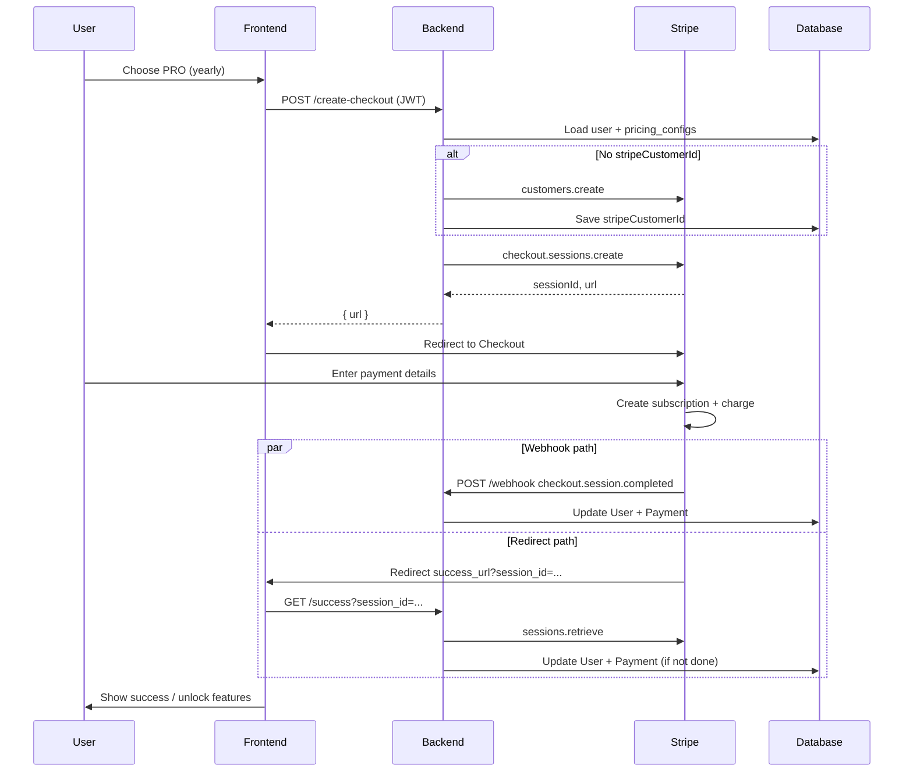

# Stripe Checkout & Payment Process

This document explains how the Fellini backend creates Stripe Checkout Sessions, how Stripe fits into the flow, and what happens from checkout through subscription activation and renewals.

---

## Table of Contents

1. [High-Level Overview](#1-high-level-overview)
2. [How Stripe Works (Concepts)](#2-how-stripe-works-concepts)
3. [Project Architecture](#3-project-architecture)
4. [Environment Variables](#4-environment-variables)
5. [Database Models](#5-database-models)
6. [Subscription Checkout — Step by Step](#6-subscription-checkout--step-by-step)
7. [What Happens After Payment](#7-what-happens-after-payment)
8. [One-Time Payment (30-Day Access)](#8-one-time-payment-30-day-access)
9. [Webhooks — Events & Handlers](#9-webhooks--events--handlers)
10. [Subscription Management](#10-subscription-management)
11. [API Reference](#11-api-reference)
12. [Frontend Integration](#12-frontend-integration)
13. [Stripe Dashboard Setup](#13-stripe-dashboard-setup)
14. [Troubleshooting](#14-troubleshooting)

---

## 1. High-Level Overview

The backend does **not** collect card numbers directly. It creates a **Stripe Checkout Session**, returns a hosted Stripe URL, and the user pays on Stripe’s secure page. After payment, the backend activates the user’s plan in the database using:

1. **Webhook** (recommended, reliable) — Stripe calls your server in the background
2. **Success redirect** (optional backup) — User lands on a URL with `session_id`; backend verifies with Stripe API

```
┌──────────┐    POST /create-checkout     ┌──────────┐    sessions.create    ┌────────┐
│ Frontend │ ─────────────────────────────► │ Backend  │ ────────────────────► │ Stripe │
└──────────┘    returns { url }            └──────────┘                         └────────┘
     │                                              ▲                                  │
     │ redirect user to session.url                 │                                  │
     └──────────────────────────────────────────────┼──────────────────────────────────┘
                                                    │
                    ┌───────────────────────────────┴───────────────────────────────┐
                    │                                                                 │
            Webhook POST /webhook                                          GET /success?session_id=...
            (checkout.session.completed)                                   handlePaymentSuccess()
                    │                                                                 │
                    └───────────────────────────────┬───────────────────────────────┘
                                                    ▼
                                          Update User + Payment record
                                          subscriptionPlan = PRO | STARTER | ULTIMATE
```

---

## 2. How Stripe Works (Concepts)

| Stripe object | Role in this project |
|---------------|----------------------|
| **Customer** | One Stripe customer per app user (`User.stripeCustomerId`). Created on first checkout. |
| **Product / Price** | Plans (STARTER, PRO, ULTIMATE) with monthly/yearly prices. Price IDs stored in `pricing_configs` table. |
| **Checkout Session** | Temporary hosted payment page. Backend creates it via API; user opens `session.url`. |
| **Subscription** | Recurring billing (`mode: "subscription"`). Stripe auto-charges each month/year. |
| **Payment Intent / Invoice** | Stripe’s internal payment records. Linked to checkout and renewals. |
| **Webhook** | HTTP POST from Stripe when events occur (payment succeeded, subscription canceled, etc.). |

**Important:** Your backend stores **Price IDs** (e.g. `price_1U7TTzPc4Do23EYowV1trkCj`), not raw card data. Amounts and billing interval come from Stripe Products configured in the Stripe Dashboard (or synced via seed).

---

## 3. Project Architecture

| Layer | File | Responsibility |
|-------|------|----------------|
| Routes | `src/routes/payment.routes.js` | Maps HTTP paths to controllers |
| Controller | `src/controllers/paymentController.js` | Validates input, HTTP responses |
| Service | `src/services/paymentService.js` | Stripe SDK calls, DB updates, webhooks |
| Server | `src/server.js` | Raw body parser for webhook (signature verification) |
| Pricing seed | `prisma/seed-pricing.js` | Plan prices + Stripe Price IDs in DB |
| Constants | `src/utils/constants.js` | Marketing features, limits (`PLAN_FEATURES`, `PLAN_LIMITS`) |
| Plan enforcement | `src/services/planFeatureService.js` | Gates features by `User.subscriptionPlan` |

All payment routes are mounted at:

```
/api/v1/payments/*
```

---

## 4. Environment Variables

```env
# Required for any Stripe operation
STRIPE_SECRET_KEY=sk_test_...          # or sk_live_... in production

# Required for webhook signature verification
STRIPE_WEBHOOK_SECRET=whsec_...

# Where Stripe redirects after checkout
STRIPE_SUCCESS_URL=https://your-frontend.com/payment/success?session_id={CHECKOUT_SESSION_ID}
STRIPE_CANCEL_URL=https://your-frontend.com/payment/cancel

# Used for billing portal return URL
FRONTEND_URL=https://your-frontend.com
```

**Notes:**

- `{CHECKOUT_SESSION_ID}` is replaced by Stripe automatically in `success_url`.
- Webhook route uses **raw JSON body** (see `server.js`) — required for `stripe.webhooks.constructEvent()`.
- Without `STRIPE_WEBHOOK_SECRET`, webhooks fail with a configuration error.

---

## 5. Database Models

### User (subscription fields)

| Field | Purpose |
|-------|---------|
| `subscriptionPlan` | `FREE`, `STARTER`, `PRO`, `ULTIMATE` — drives feature access |
| `subscriptionStatus` | `ACTIVE`, `PAST_DUE`, `CANCELED`, `TRIALING`, etc. |
| `subscriptionStartDate` / `subscriptionEndDate` | Access window (set on first payment) |
| `currentPeriodEnd` | Current billing period end (synced from Stripe on updates) |
| `cancelAtPeriodEnd` | User requested cancel; access until period end |
| `stripeCustomerId` | Links user to Stripe Customer |

### Payment

Records each successful (or failed) charge: amount, plan, `stripeCheckoutSessionId`, `stripeInvoiceId`, etc.

### PricingConfig (`pricing_configs`)

| Field | Purpose |
|-------|---------|
| `plan` | STARTER, PRO, ULTIMATE |
| `monthlyPrice` / `yearlyPrice` | Display amounts |
| `stripePriceIdMonthly` / `stripePriceIdYearly` | Used in Checkout `line_items` |

Seed with:

```bash
node prisma/seed-pricing.js
```

---

## 6. Subscription Checkout — Step by Step

### Step 1 — Frontend requests checkout

**Request**

```http
POST /api/v1/payments/create-checkout
Authorization: Bearer <JWT>
Content-Type: application/json

{
  "plan": "PRO",
  "billingPeriod": "yearly"
}
```

**Controller** (`paymentController.createStripeCheckout`):

- Validates `plan` ∈ `STARTER | PRO | ULTIMATE`
- Validates `billingPeriod` ∈ `monthly | yearly`
- Calls `paymentService.createCheckoutSession(userId, plan, billingPeriod)`

### Step 2 — Service loads user and pricing

**File:** `src/services/paymentService.js` → `createCheckoutSession()`

1. Load user (`email`, `fullName`, `stripeCustomerId`)
2. Load `pricingConfig` for the plan from DB
3. Select price ID:
   - `yearly` → `stripePriceIdYearly`
   - `monthly` → `stripePriceIdMonthly`
4. If no `stripeCustomerId`, call `stripe.customers.create()` and save ID on user

### Step 3 — Create Checkout Session

```javascript
stripe.checkout.sessions.create({
  customer: customerId,
  payment_method_types: ["card", "link"],
  line_items: [{ price: stripePriceId, quantity: 1 }],
  mode: "subscription",
  success_url: process.env.STRIPE_SUCCESS_URL,
  cancel_url: process.env.STRIPE_CANCEL_URL,
  metadata: {
    userId: user.id,
    plan: plan,
    billingPeriod: billingPeriod,
  },
});
```

**Response to frontend:**

```json
{
  "success": true,
  "message": "Checkout session created successfully",
  "data": {
    "sessionId": "cs_test_...",
    "url": "https://checkout.stripe.com/c/pay/cs_test_..."
  }
}
```

### Step 4 — User pays on Stripe

Frontend redirects: `window.location.href = data.url`

User enters card / Link / Apple Pay / Google Pay on Stripe’s hosted page.

### Step 5 — Stripe completes payment

Stripe:

1. Creates a **Subscription** for the customer
2. Charges the first invoice
3. Fires **`checkout.session.completed`** webhook
4. Redirects browser to `success_url` with `session_id`

---

## 7. What Happens After Payment

There are **two parallel paths** that activate the subscription. Both are idempotent (duplicate processing is skipped if a `Payment` row already exists for that session).

### Path A — Webhook (primary, production)

```
Stripe → POST /api/v1/payments/webhook
       → paymentService.handleWebhook()
       → _handleCheckoutCompleted(session)
```

**Updates:**

- `User.subscriptionPlan`, `subscriptionStatus: ACTIVE`, dates, `userStatus: ACTIVE`
- Creates `Payment` record
- Activity logs + confirmation email

### Path B — Success redirect (backup)

```
Browser → GET /api/v1/payments/success?session_id=cs_...
        → paymentService.handlePaymentSuccess(sessionId)
```

**Logic:**

1. `stripe.checkout.sessions.retrieve(sessionId)` with expand
2. Verify `payment_status === "paid"`
3. Read `metadata.userId`, `plan`, `billingPeriod`
4. If payment already recorded → return early (optionally fix plan mismatch)
5. Else update user + create payment (same as webhook path)

**Frontend pattern (recommended):**

If `STRIPE_SUCCESS_URL` points to your React app, the success page should call the backend:

```http
GET /api/v1/payments/success?session_id={{session_id from URL}}
```

Or proxy through your frontend to verify activation before showing “Welcome to Pro”.

### Why webhooks matter

| Scenario | Webhook | Success URL only |
|----------|---------|------------------|
| User closes tab after paying | ✅ Still activates | ❌ May not activate |
| Monthly/yearly renewal | ✅ `invoice.payment_succeeded` | ❌ Not triggered |
| Payment failed | ✅ `invoice.payment_failed` → `PAST_DUE` | ❌ Not handled |
| Cancel in Stripe / portal | ✅ `subscription.deleted` → FREE | ❌ Not synced |

**Production:** Always configure webhooks in Stripe Dashboard.

---

## 8. One-Time Payment (30-Day Access)

Separate flow — **not** a subscription.

**Request**

```http
POST /api/v1/payments/one-time-checkout
Authorization: Bearer <JWT>

{ "plan": "PRO" }
```

**Checkout session differences:**

- `mode: "payment"` (one-time)
- `line_items` use `price_data` (USD, amount from `monthlyPrice`)
- `metadata.paymentType: "one_time_30_days"`

After payment, `_handleOneTimePaymentSuccess()` grants **30 days** of plan access without auto-renewal.

---

## 9. Webhooks — Events & Handlers

**Endpoint:** `POST /api/v1/payments/webhook`  
**Registered in `server.js` before JSON parser** (raw body required).

| Event | Handler | Effect |
|-------|---------|--------|
| `checkout.session.completed` | `_handleCheckoutCompleted` | Activate plan, create payment |
| `customer.subscription.created` | `_handleSubscriptionCreated` | Log only |
| `customer.subscription.updated` | `_handleSubscriptionUpdated` | Sync status, `currentPeriodEnd`, `cancelAtPeriodEnd` |
| `customer.subscription.deleted` | `_handleSubscriptionDeleted` | Downgrade to `FREE`, `CANCELED` |
| `invoice.payment_succeeded` | `_handlePaymentSucceeded` | Record recurring payment in `payments` |
| `invoice.payment_failed` | `_handlePaymentFailed` | Record failure, set `PAST_DUE` |

**Security:** Signature verified with `STRIPE_WEBHOOK_SECRET` via `stripe.webhooks.constructEvent()`.

### Local webhook testing

```bash
stripe listen --forward-to localhost:3000/api/v1/payments/webhook
```

Copy the printed `whsec_...` into `.env` as `STRIPE_WEBHOOK_SECRET`.

---

## 10. Subscription Management

| Action | API | Stripe behavior |
|--------|-----|-----------------|
| View status | `GET /subscription-status` | Reads DB + optional Stripe subscription |
| Cancel | `POST /cancel-subscription` | `cancel_at_period_end: true` — access until period end |
| Reactivate | `POST /reactivate-subscription` | Removes cancel-at-period-end flag |
| Change plan | `POST /change-subscription` | Updates subscription item price (proration) |
| Billing portal | `GET /billing-portal` | Stripe Customer Portal URL |
| Payment history | `GET /history` | Lists `payments` for user |

**Cancel flow:**

1. Backend finds active Stripe subscription for `stripeCustomerId`
2. Sets `cancel_at_period_end: true` in Stripe
3. Sets `User.cancelAtPeriodEnd = true`
4. When period ends, Stripe sends `customer.subscription.deleted` → user downgraded to FREE

---

## 11. API Reference

| Method | Path | Auth | Description |
|--------|------|------|-------------|
| GET | `/api/v1/payments/plans` | No | Public plan list with features/limits |
| POST | `/api/v1/payments/create-checkout` | Yes | Create subscription checkout session |
| POST | `/api/v1/payments/one-time-checkout` | Yes | Create 30-day one-time checkout |
| GET | `/api/v1/payments/success` | No | Verify session & activate (query: `session_id`) |
| GET | `/api/v1/payments/cancel` | No | Cancel redirect landing (JSON message) |
| POST | `/api/v1/payments/webhook` | Stripe signature | Webhook receiver |
| GET | `/api/v1/payments/subscription-status` | Yes | Current subscription info |
| POST | `/api/v1/payments/cancel-subscription` | Yes | Cancel at period end |
| POST | `/api/v1/payments/reactivate-subscription` | Yes | Undo pending cancel |
| POST | `/api/v1/payments/change-subscription` | Yes | Upgrade/downgrade plan |
| GET | `/api/v1/payments/history` | Yes | Payment history |
| GET | `/api/v1/payments/billing-portal` | Yes | Stripe billing portal URL |

**Related (user plan features):**

```http
GET /api/v1/users/plan-features
Authorization: Bearer <JWT>
```

Returns current plan, feature flags, limits, and usage counters.

---

## 12. Frontend Integration

### Typical subscription purchase flow

```javascript
// 1. Create checkout
const res = await fetch('/api/v1/payments/create-checkout', {
  method: 'POST',
  headers: {
    'Authorization': `Bearer ${token}`,
    'Content-Type': 'application/json',
  },
  body: JSON.stringify({ plan: 'PRO', billingPeriod: 'yearly' }),
});
const { data } = await res.json();

// 2. Redirect to Stripe
window.location.href = data.url;
```

### Success page

```javascript
// URL: /payment/success?session_id=cs_test_...
const params = new URLSearchParams(window.location.search);
const sessionId = params.get('session_id');

const verify = await fetch(
  `${API_BASE}/api/v1/payments/success?session_id=${sessionId}`
);
const result = await verify.json();
// Show confirmation, refresh user/plan state
```

### Check plan before gating UI

Use `GET /api/v1/users/plan-features` or user object from auth — features are enforced server-side in `planFeatureService.js`.

---

## 13. Stripe Dashboard Setup

1. **Products & Prices** — Create STARTER / PRO / ULTIMATE with monthly and yearly prices (USD).
2. **Copy Price IDs** — Into `prisma/seed-pricing.js`, then run seed.
3. **Webhooks** — Add endpoint `https://your-api.com/api/v1/payments/webhook` with events:
   - `checkout.session.completed`
   - `customer.subscription.updated`
   - `customer.subscription.deleted`
   - `invoice.payment_succeeded`
   - `invoice.payment_failed`
4. **Customer Portal** — Enable in Stripe Dashboard for cancel/update payment method (used by `/billing-portal`).
5. **Branding** — Logo, colors, product descriptions (what users see on Checkout page).

---

## 14. Troubleshooting

| Problem | Likely cause | Fix |
|---------|--------------|-----|
| “Stripe not configured” | Missing `STRIPE_SECRET_KEY` | Add to `.env`, restart server |
| User paid but still FREE | No webhook + success page didn’t verify | Enable webhook; call `/success?session_id=` |
| Webhook 400 signature error | Wrong secret or JSON body parsed | Use raw route in `server.js`; correct `STRIPE_WEBHOOK_SECRET` |
| “Stripe Price ID not configured” | DB missing price IDs | Run `node prisma/seed-pricing.js` |
| Cancel doesn’t downgrade | Webhook not receiving `subscription.deleted` | Add event in Stripe Dashboard |
| Duplicate payments | Both webhook and success ran | Safe by design — second run returns `alreadyProcessed` |

---

## Sequence Diagram (Full Subscription Flow)



---

## Key Source Files

| File | Key functions |
|------|---------------|
| `src/services/paymentService.js` | `createCheckoutSession`, `handlePaymentSuccess`, `handleWebhook`, `createOneTimeCheckout` |
| `src/controllers/paymentController.js` | HTTP handlers for all payment routes |
| `src/routes/payment.routes.js` | Route definitions |
| `src/server.js` | Webhook raw body middleware (line ~59–63) |
| `prisma/seed-pricing.js` | Stripe Price IDs per plan |

---

*Last updated to match the codebase in `fellini_backend` (Stripe subscription + one-time checkout, webhook + success redirect activation).*
